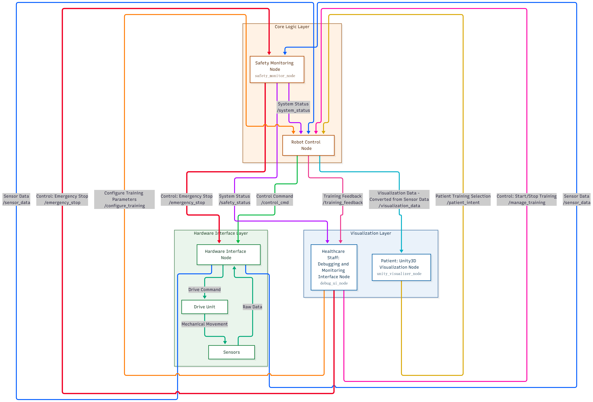
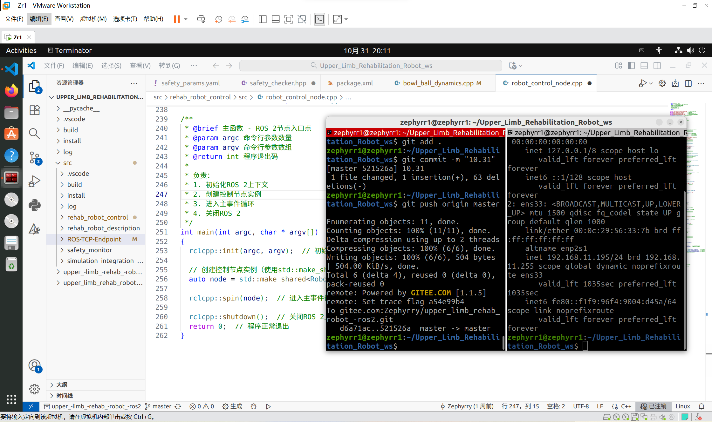
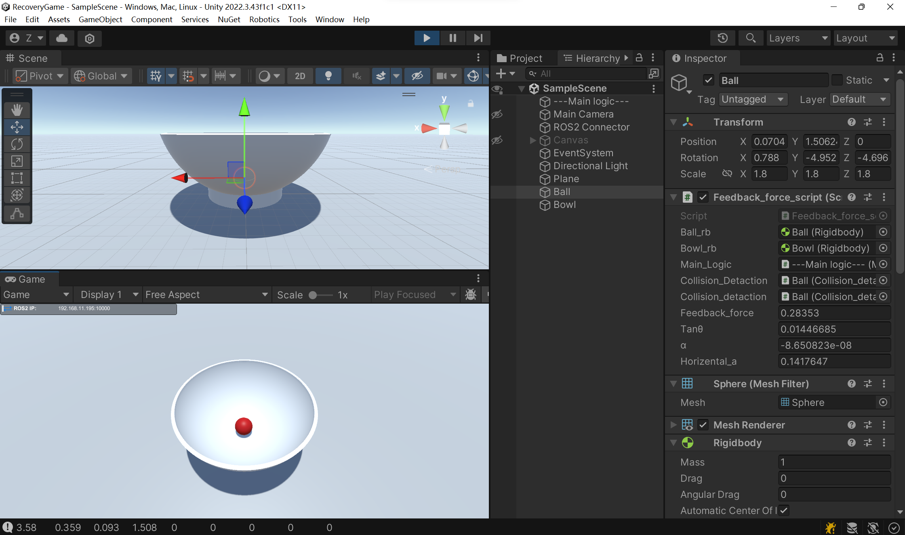

# Upper-Limb Rehabilitation Robot — ROS 2

A robotics and mechatronics project focused on the software development and integration of an upper-limb rehabilitation robot using ROS 2.

This repository is part of my engineering portfolio in robotics, sensor integration, and robot software development. It documents the ROS 2 software workspace associated with the rehabilitation robot.

## Project Overview

Upper-limb rehabilitation robots can support structured arm-motion training by combining mechanical systems, sensing, and robot software.

The goal of this project is to develop and organize the software components needed for a ROS 2-based rehabilitation robot system.

### Project Scope

- ROS 2 workspace organization and package-based development.
- Integration of robot software components within a common workspace.
- Preparation for communication between sensing and robot-control components.
- A foundation for further development, testing, and hardware integration.

The exact capabilities available in the current version depend on the implemented ROS 2 packages and connected hardware.

## Relationship to the Sensor Module

The companion repository [`hand-fsr-sensor-visualization`](https://github.com/Ruoyizhu/hand-fsr-sensor-visualization) contains a hand force-sensing and visualization application developed as a sensor-acquisition module for this rehabilitation robot project.

The sensor application currently provides a standalone Python GUI and serial-data acquisition functionality. ROS 2 integration should be treated as a separate integration task unless implemented and verified in the current system.

## Demonstrations

### ROS 2 Runtime and System Architecture

The following images illustrate the project structure and ROS 2 software execution.







### Video Demonstrations

**Patient Unity Interface**

[Watch or download the demonstration video](https://github.com/Ruoyizhu/upper-limb-rehabilitation-robot-ros2/releases/download/demo-v1.0/patient-unity-interface-demo.mp4)

**Sensor Data Acquisition Interface**

[Watch or download the demonstration video](https://github.com/Ruoyizhu/upper-limb-rehabilitation-robot-ros2/releases/download/demo-v1.0/sensor-data-acquisition-demo.mp4)

The videos are hosted as GitHub Release assets to keep large video files out of the source repository.

## Technology

- **Middleware:** ROS 2
- **Development:** ROS 2 workspace and package-based software development
- **Related sensing module:** Python, PyQt6, NumPy, pyqtgraph, and pyserial

The ROS 2 distribution and additional dependencies should be selected according to the package manifests and the target environment.

## Repository Structure

```text
upper-limb-rehabilitation-robot-ros2/
├── docs/
│   ├── images/
│   │   ├── README.md
│   │   ├── architecture.png
│   │   ├── ros2-process.png
│   │   └── ros2-runtime.png
│   └── demos/
│       └── README.md
├── src/
├── LICENSE
└── README.md
```

The repository may also contain generated build and runtime directories. These are not normally required in version control and should be regenerated locally.

## Prerequisites

Before building the workspace, install a ROS 2 distribution compatible with the packages in `src/`.

Verify your installation:

```bash
printenv ROS_DISTRO
ros2 --help
```

If `ROS_DISTRO` is empty, source the setup script for your installed ROS 2 distribution.

## Build

From the repository root:

```bash
source /opt/ros/$ROS_DISTRO/setup.bash
colcon build --symlink-install
source install/setup.bash
```

If the workspace contains packages with additional system or Python dependencies, install those dependencies before building.

## Inspect Available Packages

List the packages discovered by the workspace:

```bash
colcon list
```

After building, inspect the packages available to ROS 2:

```bash
ros2 pkg list
```

To inspect the nodes and launch files provided by an individual package:

```bash
ros2 pkg executables <package_name>
ros2 launch <package_name> <launch_file>
```

Replace the placeholders with package names and launch files that actually exist in the repository.

## Development and Validation

A reproducible development workflow should include:

1. Checking package manifests and dependencies.
2. Building the workspace from a clean environment.
3. Testing individual nodes and launch files.
4. Validating message flow and component communication.
5. Testing hardware interfaces separately before system-level integration.

Actual hardware operation and rehabilitation functionality must be verified on the target system before being considered supported.

## Current Status

This repository is being organized as a public engineering portfolio project.

For a reproducible release, the following information should be documented as it is verified:

- Supported ROS 2 distribution and operating system.
- Implemented packages and their responsibilities.
- Available launch files and runtime commands.
- Connected hardware and communication interfaces.
- Simulation or hardware validation results.

## Future Work

Potential areas for further development include:

- Documenting the robot software architecture and data flow.
- Integrating sensor data with ROS 2 topics.
- Adding automated tests and system-level validation.
- Providing reproducible launch configurations and demonstration recordings.

These items are development directions, not claims of completed functionality.

## License

See [LICENSE](LICENSE) for the applicable license and terms.

## Related Project

- [Hand FSR Sensor Visualization](https://github.com/Ruoyizhu/hand-fsr-sensor-visualization) — the companion hand force-sensor acquisition and visualization module.
